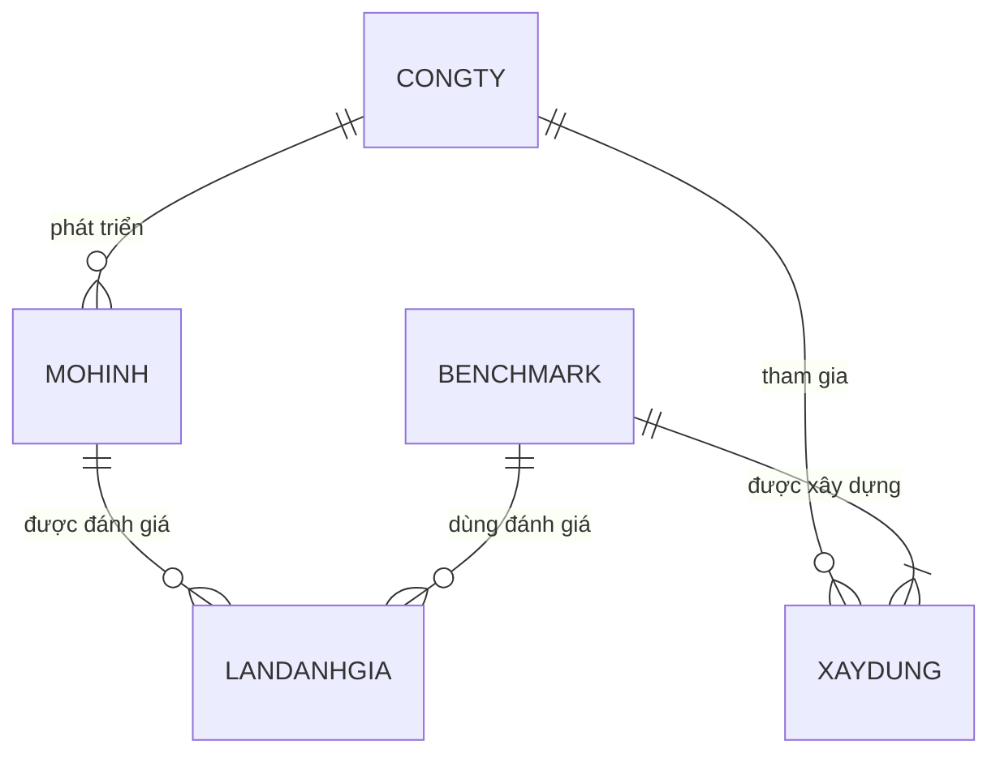

# Giải Đề 1 giữa kỳ CSDL, học kỳ I 2026–2027

Nguồn đề: hai ảnh người dùng gửi ngày 04/11/2026. Lời giải dưới đây được xây dựng từ đề; không phải đáp án chính thức của giảng viên. Không dùng lời giải này để suy ra kết quả bài thi hoặc mức thành thạo của người dùng.

## Câu 1 — Mô hình ER và mô hình quan hệ (2,5 điểm)

### 1.1. Mô hình thực thể – mối kết hợp

Ba loại thực thể chính; **chữ đậm là khóa**:

| Thực thể | Thuộc tính |
|---|---|
| CONGTY | **MaCT**, TenCT, QuocGia |
| MOHINH | **MaMH**, TenMH, NgayPhatHanh, SoLuongThamSo |
| BENCHMARK | **MaBM**, TenBM, LinhVucDG, ThangDiemToiDa |

Các mối kết hợp:

- **PHAT_TRIEN:** CONGTY `(0,n)` — PHAT_TRIEN — `(1,1)` MOHINH. Mỗi mô hình do đúng một công ty phát triển; công ty có thể chưa phát triển mô hình nào.
- **XAYDUNG:** CONGTY `(0,n)` — XAYDUNG — `(1,n)` BENCHMARK. Đây là mối kết hợp nhiều–nhiều, có thuộc tính **VaiTro**. Mỗi benchmark bắt buộc có ít nhất một công ty xây dựng.
- **Đánh giá:** một mô hình và một benchmark đều có thể tham gia `(0,n)` lần đánh giá. Mỗi lần thuộc đúng một mô hình và đúng một benchmark, có **ThoiDiemDG, DiemSo**.

Do cùng cặp mô hình–benchmark được đánh giá nhiều lần, biểu diễn **LANDANHGIA** thành thực thể kết hợp, định danh bằng **(MaMH, MaBM, ThoiDiemDG)**. Không dùng riêng cặp `(MaMH, MaBM)` làm khóa của lần đánh giá.

Sơ đồ dưới đây biểu diễn XAYDUNG và LANDANHGIA bằng thực thể kết hợp; các thuộc tính được liệt kê ở trên và trong lược đồ bên dưới:



### 1.2. Chuyển sang mô hình quan hệ

```text
CONGTY(MaCT, TenCT, QuocGia)
    PK: MaCT

MOHINH(MaMH, TenMH, NgayPhatHanh, SoLuongThamSo, MaCT)
    PK: MaMH
    FK: MaCT → CONGTY(MaCT), NOT NULL

BENCHMARK(MaBM, TenBM, LinhVucDG, ThangDiemToiDa)
    PK: MaBM

XAYDUNG(MaCT, MaBM, VaiTro)
    PK: (MaCT, MaBM)
    FK: MaCT → CONGTY(MaCT)
        MaBM → BENCHMARK(MaBM)

LANDANHGIA(MaMH, MaBM, ThoiDiemDG, DiemSo)
    PK: (MaMH, MaBM, ThoiDiemDG)
    FK: MaMH → MOHINH(MaMH)
        MaBM → BENCHMARK(MaBM)
```

Ràng buộc cần giữ thêm: mỗi BENCHMARK phải có ít nhất một dòng XAYDUNG tương ứng. Chỉ khai báo khóa ngoại chưa bảo đảm được số lượng tối thiểu này.

## Câu 2.1 — SQL (1,5 điểm)

Dùng cú pháp SQL Server. Các yêu cầu độc lập, cùng dựa trên trạng thái dữ liệu của đề.

### a. Giá thuê thỏa thuận từ 100.000đ đến 5.000.000đ

```sql
ALTER TABLE CTTHUE
ADD CONSTRAINT CK_CTTHUE_GiaThueTT
CHECK (GiaThueTT BETWEEN 100000 AND 5000000);
```

Hai đầu mút đều được lấy.

### b. Mỗi sự cố phải được ghi nhận cho một chi tiết thuê

```sql
ALTER TABLE SUCO
ADD CONSTRAINT FK_SUCO_CTTHUE
FOREIGN KEY (MaCTT) REFERENCES CTTHUE(MaCTT);
```

Tân từ đã quy định SUCO.MaCTT không được rỗng. Nếu cột chưa được khai báo NOT NULL, có thể bảo đảm yêu cầu này mà không cần giả định kiểu dữ liệu bằng:

```sql
ALTER TABLE SUCO
ADD CONSTRAINT CK_SUCO_MaCTT_KhongRong
CHECK (MaCTT IS NOT NULL);
```

Khóa ngoại bảo đảm chi tiết thuê tồn tại; điều kiện không rỗng bảo đảm sự cố luôn gắn với một chi tiết thuê.

### c. Tăng giá thuê niêm yết và tiền cọc của máy chiếu thêm 20.000đ

```sql
UPDATE THIETBI
SET GiaThueNY = GiaThueNY + 20000,
    SoTienCoc = SoTienCoc + 20000
WHERE LoaiTB = N'Máy chiếu';
```

## Câu 2.2 — Đại số quan hệ (6 điểm)

Quy ước: `σ` chọn, `π` chiếu, `⋈` không ghi điều kiện là kết tự nhiên trên các thuộc tính cùng tên, `⟕` là kết ngoài trái, `γ` là gom nhóm, `←` là đặt tên kết quả trung gian. Phép chiếu dùng ngữ nghĩa tập hợp nên loại các bộ trùng.

### a. Máy chiếu hoặc giá niêm yết từ 500.000đ đến 1.000.000đ

\[
KQ_a\leftarrow
\pi_{\text{MaTB, TenTB, SoTienCoc}}
\left(
\sigma_{\text{LoaiTB}='\text{Máy chiếu}'\;\lor\;(500000\leq\text{GiaThueNY}\;\land\;\text{GiaThueNY}\leq1000000)}
(\mathrm{THIETBI})
\right)
\]

Dùng **hoặc**, không phải **và**.

### b. Khách hàng ký hợp đồng từ 10.000.000đ và hợp đồng đó thuê TB001

\[
H\leftarrow\sigma_{\text{TongTienThue}\geq10000000}(\mathrm{HOPDONG})
\]

\[
C\leftarrow\sigma_{\text{MaTB}='\mathrm{TB001}'}(\mathrm{CTTHUE})
\]

\[
KQ_b\leftarrow\pi_{\text{MaKH, HoTen}}
\left(\mathrm{KHACHHANG}\bowtie_{\text{MaKH}=\text{MaKHKyHD}}(H\bowtie C)\right)
\]

`H ⋈ C` nối theo SoHD, nên hai điều kiện thuộc cùng một hợp đồng. Lấy khách ký bằng **MaKHKyHD**, không lấy MaKHNhan.

### c. Máy ảnh và mã sự cố Đã xử lý, nếu có

\[
A\leftarrow\sigma_{\text{LoaiTB}='\text{Máy ảnh}'}(\mathrm{THIETBI})
\]

\[
S\leftarrow\sigma_{\text{TrangThai}='\text{Đã xử lý}'}(\mathrm{SUCO})
\]

\[
R\leftarrow\pi_{\text{MaTB, MaSC}}(\mathrm{CTTHUE}\bowtie S)
\]

\[
KQ_c\leftarrow\pi_{\text{MaTB, TenTB, MaSC}}(A\mathbin{\text{⟕}}R)
\]

Kết ngoài trái nối theo MaTB. Thiết bị không có sự cố Đã xử lý vẫn xuất hiện, với MaSC = NULL. Phải lọc trạng thái trước kết ngoài, tránh làm mất các thiết bị cần giữ.

### d. Hợp đồng ký năm 2026 thuê đồng thời máy chiếu và âm thanh

\[
M\leftarrow\pi_{\text{SoHD}}
\left(\mathrm{CTTHUE}\bowtie\sigma_{\text{LoaiTB}='\text{Máy chiếu}'}(\mathrm{THIETBI})\right)
\]

\[
A\leftarrow\pi_{\text{SoHD}}
\left(\mathrm{CTTHUE}\bowtie\sigma_{\text{LoaiTB}='\text{Âm thanh}'}(\mathrm{THIETBI})\right)
\]

\[
H\leftarrow\sigma_{\text{NgayKy}\geq'2026-01-01'\;\land\;\text{NgayKy}<'2027-01-01'}(\mathrm{HOPDONG})
\]

\[
KQ_d\leftarrow\pi_{\text{SoHD, MaKH, HoTen}}
\left(\mathrm{KHACHHANG}\bowtie_{\text{MaKH}=\text{MaKHKyHD}}(H\bowtie(M\cap A))\right)
\]

Giao theo SoHD bảo đảm cùng một hợp đồng có cả hai loại. Không buộc một dòng THIETBI có đồng thời hai giá trị LoaiTB.

### e. Hợp đồng ký năm 2026, Đã thanh lý, thuê tất cả âm thanh có giá niêm yết trên 500.000đ

Tập hợp đồng ứng viên:

\[
H\leftarrow\sigma_{\text{NgayKy}\geq'2026-01-01'\;\land\;\text{NgayKy}<'2027-01-01'\;\land\;\text{TinhTrang}='\text{Đã thanh lý}'}(\mathrm{HOPDONG})
\]

Tập thiết bị bắt buộc phải thuê và quan hệ hợp đồng–thiết bị đã thuê:

\[
B\leftarrow\pi_{\text{MaTB}}
\left(\sigma_{\text{LoaiTB}='\text{Âm thanh}'\;\land\;\text{GiaThueNY}>500000}(\mathrm{THIETBI})\right)
\]

\[
R\leftarrow\pi_{\text{SoHD, MaTB}}(\mathrm{CTTHUE})
\]

Nếu B không rỗng, dùng phép chia:

\[
D\leftarrow\pi_{\text{SoHD}}(H)\cap(R\div B)
\]

\[
KQ_e\leftarrow\pi_{\text{SoHD, MaKH, HoTen}}
\left(\mathrm{KHACHHANG}\bowtie_{\text{MaKH}=\text{MaKHKyHD}}(H\bowtie D)\right)
\]

Đề không bảo đảm B có phần tử. Để biểu thức đúng cả khi B rỗng, thay dòng định nghĩa D bằng:

\[
U\leftarrow\pi_{\text{SoHD}}(H)
\]

\[
D\leftarrow U-\pi_{\text{SoHD}}\left((U\times B)-R\right)
\]

`(U × B) − R` là các cặp hợp đồng–thiết bị còn thiếu; loại các hợp đồng thiếu ít nhất một thiết bị bắt buộc. Hợp đồng vẫn được phép thuê thêm thiết bị khác.

### f. Khách nhận 3 thiết bị khác nhau trong năm 2026, mỗi thiết bị có ít nhất 2 sự cố trong lịch sử

**Cách hiểu dùng ở lời giải chính:** khách nhận đúng 3 thiết bị khác nhau trong năm 2026 và cả 3 thiết bị đều có ít nhất 2 sự cố trong toàn bộ lịch sử. Đề không ghi “ít nhất 3”.

Đếm sự cố theo thiết bị, không giới hạn năm hay trạng thái:

\[
T\leftarrow\gamma_{\text{MaTB};\;\operatorname{COUNT}(\text{MaSC})\to\text{SoSC}}
(\mathrm{CTTHUE}\bowtie\mathrm{SUCO})
\]

\[
B\leftarrow\pi_{\text{MaTB}}\left(\sigma_{\text{SoSC}\geq2}(T)\right)
\]

Lấy cặp khách nhận–thiết bị trong năm 2026; chiếu để một khách nhận cùng thiết bị qua nhiều hợp đồng chỉ được tính một lần:

\[
P\leftarrow\pi_{\text{MaKHNhan, MaTB}}
\left(\sigma_{\text{NgayNhan}\geq'2026-01-01'\;\land\;\text{NgayNhan}<'2027-01-01'}(\mathrm{CTTHUE})\right)
\]

Đếm tổng thiết bị đã nhận và số thiết bị đạt điều kiện sự cố:

\[
N\leftarrow\gamma_{\text{MaKHNhan};\;\operatorname{COUNT}(\text{MaTB})\to\text{SoTB}}(P)
\]

\[
G\leftarrow\gamma_{\text{MaKHNhan};\;\operatorname{COUNT}(\text{MaTB})\to\text{SoTBDat}}(P\bowtie B)
\]

\[
K\leftarrow\pi_{\text{MaKHNhan}}
\left(\sigma_{\text{SoTB}=3\;\land\;\text{SoTBDat}=3}(N\bowtie G)\right)
\]

\[
KQ_f\leftarrow\pi_{\text{MaKH, HoTen}}
\left(\mathrm{KHACHHANG}\bowtie_{\text{MaKH}=\text{MaKHNhan}}K\right)
\]

**Điểm mơ hồ:** nếu ý người ra đề là chỉ cần đúng 3 thiết bị đạt điều kiện, còn khách có thể nhận thêm thiết bị khác không đạt, thay K bằng:

\[
K\leftarrow\pi_{\text{MaKHNhan}}\left(\sigma_{\text{SoTBDat}=3}(G)\right)
\]

Nếu hiểu là ít nhất 3 thiết bị đạt điều kiện, dùng SoTBDat ≥ 3. Không giới hạn sự cố trong năm 2026 hoặc chỉ ở những lần thuê của riêng khách đó: đề ghi rõ lịch sử ghi nhận của công ty.

## Tài liệu lý thuyết đối chiếu

- T1 trang PDF 43–53: khóa, mối kết hợp, thuộc tính quan hệ, bản số.
- T2 trang PDF 46–52: chuyển thực thể và mối kết hợp sang mô hình quan hệ.
- T3 trang PDF 36–44, 45–56, 60: kết ngoài, giao/trừ, chia và gom nhóm.
- T4 trang PDF 12–13, 22–24, 36–37: ràng buộc và UPDATE.
